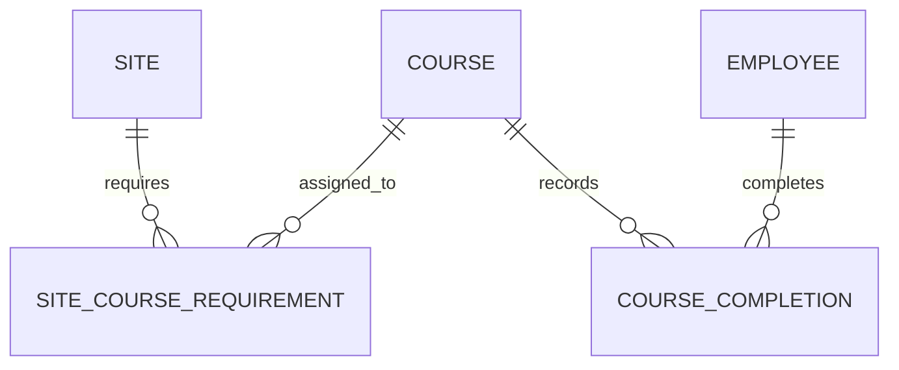

# NME Training Database Design

Status: implemented in Prisma, PostgreSQL migration SQL, Fastify, and the
shared seed.

## Product Rules

1. Selecting any active site shows every active employee.
2. Every course assigned to a site applies equally to every employee.
3. Employees contain only a display name and archive state. Job title, crew,
   home base, and external HR identifiers are outside the product.
4. An active course is assigned to one or many sites.
5. One completion can satisfy the same course at every site where it is
   assigned.
6. Site-specific training is represented by a distinct course assigned only to
   that site.
7. Company-wide mandatory courses are not modeled.
8. Expiry is calculated from the course validity period when a completion is
   recorded.
9. An employee is eligible only when every course required by the selected
   site is current.
10. A site with no assigned courses shows every employee as `noRequirements`
    and ineligible.
11. Certificates, providers, approval workflows, waivers, equivalents, grace
    periods, and temporary access are outside v1.

The canonical demo dataset contains eight employees, four sites, twelve
courses, twelve site-course assignments, and 83 completion records. Its fixed
June 5, 2026 readiness results are shared by the frontend demo repository and
server seed.

## Domain Model

The production model contains five tables:

1. `employee`
2. `site`
3. `course`
4. `site_course_requirement`
5. `course_completion`

No customer, employee-site assignment, audit-event, role, crew, or
employee-requirement table is needed.

## Tables

### `employee`

- `id uuid primary key`
- `display_name varchar(160) not null`
- `cognito_subject varchar(255) null unique`
- `archived_at timestamptz null`
- `created_at timestamptz not null`
- `updated_at timestamptz not null`

Names are not unique because different employees may have the same name.
Archiving removes an employee from readiness while preserving completions.
`cognito_subject` links one Cognito account to one employee. It is nullable so
employee records can exist before an account is provisioned. Authorization
uses the verified Cognito `sub`, never a name or email match.

### `site`

- `id uuid primary key`
- `name varchar(160) not null`
- `time_zone varchar(80) not null`
- `archived_at timestamptz null`
- `created_at timestamptz not null`
- `updated_at timestamptz not null`

Active site names are globally unique case-insensitively. The time zone
determines the default evaluation date when the API receives no `asOf`.

Archiving a site hides it from current readiness views but preserves all
course assignments. Restoring the site restores those assignments unchanged.

### `course`

- `id uuid primary key`
- `name varchar(180) not null`
- `validity_months smallint not null`
- `archived_at timestamptz null`
- `created_at timestamptz not null`
- `updated_at timestamptz not null`

Course names are permanently unique case-insensitively, including after
archive. `validity_months` is an integer from 1 through 120.

Course creation and editing require at least one site assignment. The
application validates that newly assigned sites are active.

Archiving a course preserves its site assignments but suspends the course from
readiness and new completion entry. Restoring it reactivates the same
assignments.

### `site_course_requirement`

- `site_id uuid not null references site`
- `course_id uuid not null references course`
- primary key `(site_id, course_id)`

This table is a current assignment set, not a historical timeline. Duplicate
assignments are rejected by the composite primary key. Adding or removing a
row immediately changes the selected site's readiness requirements.

### `course_completion`

- `id uuid primary key`
- `employee_id uuid not null references employee`
- `course_id uuid not null references course`
- `completed_on date not null`
- `expires_on date not null`
- `validity_months_applied smallint null`
- `recorded_by_subject varchar(255) not null`
- `recorded_at timestamptz not null`
- `voided_at timestamptz null`
- `voided_by_subject varchar(255) null`
- `void_reason varchar(500) null`

Rules:

- `expires_on >= completed_on`
- new completions snapshot a positive `validity_months_applied`
- migrated legacy completions may retain a null validity snapshot
- void time, actor, and reason are either all null or all present
- an identical non-voided employee, course, and completion-date record cannot
  be inserted twice

Completion rows are immutable. Renewals create new rows; corrections void the
incorrect row with a required reason.

Expiry uses calendar-month arithmetic with month-end clamping.
January 31 plus one month becomes February 28 or 29. The API permanently stores
both `expires_on` and `validity_months_applied`, so later course changes do not
rewrite history.

## Readiness

Readiness is derived for an active site and an `asOf` date:

1. Load every active employee.
2. Load every course currently assigned to the site.
3. For each employee and course, select the latest non-voided completion whose
   completion date is on or before `asOf`.
4. Classify the requirement:
   - `incomplete`: no applicable completion
   - `overdue`: expiry before `asOf`
   - `expiring`: expiry from `asOf` through `asOf + 45 days`, inclusive
   - `compliant`: expiry after the warning window
5. Use the worst requirement status as the employee's site status.
6. Mark the employee eligible only when every requirement is `compliant` or
   `expiring`.

If the site has no assignments, every active employee is returned with
`noRequirements` and is ineligible. `asOf=YYYY-MM-DD` is retained for
deterministic evaluation, not historical requirement configuration.

## PostgreSQL Rules

The migration uses:

- native PostgreSQL UUIDs
- PostgreSQL `date` for business dates
- `timestamptz(3)` for lifecycle timestamps
- `ON DELETE RESTRICT` for business relationships
- a partial unique index on `lower(site.name)` for active sites
- a permanent unique index on `lower(course.name)`
- check constraints for completion expiry and void metadata
- a partial duplicate-completion index for non-voided rows

Prisma models map to snake_case table and column names. Unsupported partial
indexes and checks are maintained in the reviewed migration SQL.

## Archive Behavior

- Employee archive preserves all completions.
- Site archive preserves all course assignments.
- Course archive preserves assignments and suspends them from readiness.
- Archived records are restored or retained; normal application workflows do
  not physically delete them.

## RDS Deployment

Production should use PostgreSQL 17 on private Amazon RDS subnets with TLS,
encryption at rest, automated backups, point-in-time recovery, and a security
group that permits port 5432 only from the API.

Use separate credentials for migrations and the running API. The application
role needs only connection, schema usage, and DML privileges on the five
business tables. Store credentials in Secrets Manager and give the API instance
role access only to the application secret.

## Deliberately Excluded

- customers and customer contacts
- employee job title, crew, home base, and email-based identity matching
- employee-site or employee-specific requirements
- effective-dated requirement history
- per-requirement warning periods
- optimistic version columns
- general audit events
- manual expiry, bulk completion entry, and spreadsheet imports
- certificate attachments and approval workflows
