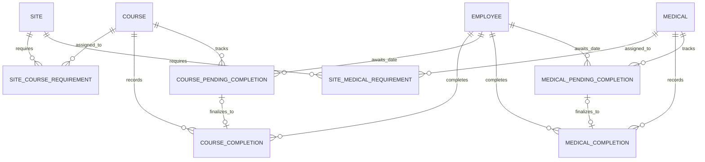

# NME Training and Medical Database Design

Status: implemented in Prisma, PostgreSQL migration SQL, Fastify, and the
shared seed.

## Product Rules

1. Selecting any active site shows every active employee to administrators and
   owners. Employee accounts see only their own record.
2. Every course or medical assigned to a site applies equally to every
   employee.
3. Employees contain a display name, email, Cognito subject, and archive state.
   Job title, crew, home base, and external HR identifiers are outside the
   product.
4. An active course or medical is assigned to one or many sites, or is
   explicitly tracked with `No Site Requirement`.
5. One completion can satisfy the same item at every site where that item is
   assigned. Course completions and medical completions remain strictly
   separate.
6. A site-specific requirement is represented by a distinct course or medical
   assigned only to that site.
7. Company-wide mandatory courses are not modeled.
8. Expiry is calculated from the corresponding course or medical validity
   period when a completion is recorded.
9. An employee is eligible only when every configured course and medical
   required by the selected site is current.
10. An empty Training or Medical domain is neutral. A site with no assigned
    requirements in either domain shows every employee as `noRequirements`
    and ineligible.
11. Administrators and owners may track one open pending completion date per
    employee and course or medical. Pending records do not affect readiness.
12. Certificates, medical providers, results, restrictions, attachments,
    manually overriding expiry during ordinary entry, approval workflows,
    waivers, equivalents, grace periods, and temporary access are outside v1.

The canonical Training demo dataset contains eight employees, four sites,
twelve courses, twelve site-course assignments, and 83 course completion
records. Its fixed June 5, 2026 Training readiness results are shared by the
frontend demo repository and server seed. The Medical catalogue, assignments,
and completion history start empty in both local seed and frontend demo mode.

## Domain Model

The production model contains ten tables:

1. `employee`
2. `site`
3. `course`
4. `site_course_requirement`
5. `course_completion`
6. `medical`
7. `site_medical_requirement`
8. `medical_completion`
9. `course_pending_completion`
10. `medical_pending_completion`

The Medical tables mirror the Course catalogue, site assignment, immutable
completion, and pending-date rules. They share foreign keys to `employee` and `site`,
but Course and Medical records never satisfy one another. Medical names are
permanently unique within the Medical namespace; a Course and Medical may have
the same name.

No customer, employee-site assignment, audit-event, role, crew, or
employee-requirement table is needed.

## Tables

### `employee`

- `id uuid primary key`
- `display_name varchar(160) not null`
- `email varchar(254) not null`
- `cognito_subject varchar(255) not null unique`
- `archived_at timestamptz null`
- `created_at timestamptz not null`
- `updated_at timestamptz not null`

Names are not unique because different employees may have the same name.
Archiving removes an employee from readiness while preserving completions.
Email is unique case-insensitively and is stored for management display, not
authorization. Every employee is created with a Cognito account, and
`cognito_subject` links that account to exactly one employee. Authorization
uses the verified Cognito `sub`, never a name or email match.

Cognito remains the source of truth for account setup state. Management loads
the live `employee` group and joins accounts to rows by `cognito_subject`:
`FORCE_CHANGE_PASSWORD` means invitation pending and `CONFIRMED` means setup
complete, not proof that the employee has used the application. Account state,
temporary passwords, and invitation-validity timestamps are not stored in
PostgreSQL. Invitation resend therefore requires no schema migration.

### `site`

- `id uuid primary key`
- `name varchar(160) not null`
- `time_zone varchar(80) not null`
- `archived_at timestamptz null`
- `created_at timestamptz not null`
- `updated_at timestamptz not null`

Active site names are globally unique case-insensitively. The time zone
determines the default evaluation date when the API receives no `asOf`.

Archiving a site hides it from current readiness views but preserves all
course and medical assignments. Restoring the site restores both assignment
sets unchanged.

### `course`

- `id uuid primary key`
- `name varchar(180) not null`
- `validity_months smallint not null`
- `archived_at timestamptz null`
- `created_at timestamptz not null`
- `updated_at timestamptz not null`

Course names are permanently unique case-insensitively, including after
archive. `validity_months` is an integer from 1 through 120.

Course creation and editing may use zero or more site assignments. A course
with no site assignments can still receive completion records, but it does not
affect readiness. The application validates that newly assigned sites are active.

Archiving a course preserves its site assignments but suspends the course from
readiness and new completion entry. Restoring it reactivates the same
assignments.

### `site_course_requirement`

- `site_id uuid not null references site`
- `course_id uuid not null references course`
- primary key `(site_id, course_id)`

This table is a current assignment set, not a historical timeline. Duplicate
assignments are rejected by the composite primary key. Adding or removing a
row immediately changes the selected site's readiness requirements.

### `course_completion`

- `id uuid primary key`
- `employee_id uuid not null references employee`
- `course_id uuid not null references course`
- `completed_on date not null`
- `expires_on date not null`
- `validity_months_applied smallint null`
- `comment varchar(500) null`
- `recorded_by_subject varchar(255) not null`
- `recorded_at timestamptz not null`
- `corrects_completion_id uuid null unique references course_completion`
- `expiry_manually_set boolean not null default false`
- `voided_at timestamptz null`
- `voided_by_subject varchar(255) null`
- `void_reason varchar(500) null`

Rules:

- `expires_on >= completed_on`
- new completions snapshot a positive `validity_months_applied`
- migrated legacy completions may retain a null validity snapshot
- void time, actor, and reason are either all null or all present
- an identical non-voided employee, course, and completion-date record cannot
  be inserted twice

Completion rows are immutable. Renewals create new rows; corrections void the
incorrect row with a required reason. Optional comments are saved at record
creation and are not edited later.

An administrator date correction creates a new active row linked through
`corrects_completion_id` after atomically voiding its source. The replacement
keeps the same employee, item, validity snapshot, comment, and correcting
actor, while allowing both date fields to change. `expiry_manually_set`
distinguishes its administrator-confirmed expiration from an ordinary
catalogue-validity calculation. A source can have only one direct replacement.

Expiry uses calendar-month arithmetic with month-end clamping.
January 31 plus one month becomes February 28 or 29. The API permanently stores
both `expires_on` and `validity_months_applied`, so later course changes do not
rewrite history.

### `medical`

- `id uuid primary key`
- `name varchar(180) not null`
- `validity_months smallint not null`
- `archived_at timestamptz null`
- `created_at timestamptz not null`
- `updated_at timestamptz not null`

Medical names are permanently unique case-insensitively within the Medical
catalogue, including after archive. A Medical and Course may use the same name
because their namespaces are independent. `validity_months` is an integer from
1 through 120.

Medical creation and editing follows the Course assignment rules. A medical
may be assigned to active sites or explicitly have `No Site Requirement`; an
unassigned medical can receive completion records but does not affect site
access. Archiving preserves assignments and history while removing the medical
from readiness and new completion entry. Restore reactivates the saved
assignments.

### `site_medical_requirement`

- `site_id uuid not null references site`
- `medical_id uuid not null references medical`
- primary key `(site_id, medical_id)`

This is the Medical domain's current assignment set. Its composite primary key
rejects duplicate assignments, and changes affect readiness immediately. It
does not share rows or identifiers with `site_course_requirement`.

### `medical_completion`

- `id uuid primary key`
- `employee_id uuid not null references employee`
- `medical_id uuid not null references medical`
- `completed_on date not null`
- `expires_on date not null`
- `validity_months_applied smallint not null`
- `comment varchar(500) null`
- `recorded_by_subject varchar(255) not null`
- `recorded_at timestamptz not null`
- `corrects_completion_id uuid null unique references medical_completion`
- `expiry_manually_set boolean not null default false`
- `voided_at timestamptz null`
- `voided_by_subject varchar(255) null`
- `void_reason varchar(500) null`

Medical completions use the same expiry, validity snapshot, all-or-none void
metadata, immutable history, renewal, comment, and month-end-clamping rules as
course completions. A partial unique index rejects an identical non-voided
employee, medical, and completion-date occurrence. Foreign keys to `employee`
and `medical` are restrictive, and a medical completion can never satisfy a
course requirement.

Medical date corrections follow the same linked-replacement and immutable
source rules as Course corrections.

### Pending completion tables

`course_pending_completion` and `medical_pending_completion` are separate
administrator workflow tables. Each stores an employee, the matching domain
item, a validity snapshot, optional comment, creator, and creation time. A
partial unique index permits only one unresolved pending record for the same
employee and item, while allowing an older dated completion to remain current.

Both tables contain:

- `id uuid primary key`
- `employee_id uuid not null references employee`
- `course_id uuid not null references course` or
  `medical_id uuid not null references medical`
- `validity_months_snapshot smallint not null`
- `comment varchar(500) null`
- `created_by_subject varchar(255) not null`
- `created_at timestamptz not null`
- `resolution pending_completion_resolution null`
- `resolved_at timestamptz null`
- `resolved_by_subject varchar(255) null`
- `cancellation_reason varchar(500) null`
- a nullable, unique `completion_id` foreign key to the matching completion
  table

An unresolved record has no resolution metadata. Finalization transactionally
creates an ordinary immutable completion using the saved validity and comment,
then links the pending record to it. The trigger verifies that the linked,
non-voided completion has the same employee, item, validity, comment, and actor.
Cancellation records the actor, time, and required reason. Database checks and
triggers permit only one unresolved-to-resolved transition and prevent
rewriting or reopening either outcome. Pending records are excluded from
readiness and employee self-service.

## Readiness

Readiness is derived for an active site and an `asOf` date from complete,
unfiltered Training and Medical data:

1. Load every active employee.
2. Load every active course and active medical currently assigned to the site.
3. For each employee and requirement, select the latest completion from the
   matching domain whose completion date is on or before `asOf`. Ignore future
   and voided completions.
4. Classify each requirement independently:
   - `incomplete`: no applicable completion
   - `overdue`: expiry before `asOf`
   - `expiring`: expiry from `asOf` through `asOf + 45 days`, inclusive
   - `compliant`: expiry after the warning window
5. Build separate Training and Medical summaries. Each top-level status and its
   required, completed, and expiring counts describe only that response's
   domain. Status precedence is `overdue`, `incomplete`, `expiring`, then
   `compliant`; an empty domain is `noRequirements`. `domainEligible` reports
   whether the visible domain is current.
6. Build `combinedAccess` from the union of both complete domain evaluations:
   - `status` is the worst status across both domains
   - `eligible` is true only when at least one requirement exists and every
     configured requirement is `compliant` or `expiring`
   - `requiredCount`, `completedCount`, and `expiringCount` sum both domains
   - `blockingDomains` lists `training`, `medical`, or both when that domain has
     an `incomplete` or `overdue` requirement

The legacy top-level `eligible` field mirrors `combinedAccess.eligible`,
preserving its site-access meaning for existing Training API consumers. Only
`combinedAccess` is used to make new site-access decisions.

An empty domain is neutral when the other domain has requirements. If neither
domain has assignments, every active employee is returned with
`combinedAccess.status = noRequirements`, zero counts, no blocking domain, and
`eligible = false`. Filters applied in the Training or Medical workspace alter
only visible domain rows and never recalculate `combinedAccess`.

The site time zone supplies the default evaluation date. Explicit
`asOf=YYYY-MM-DD` remains available for deterministic evaluation, not
historical requirement configuration. Readiness responses expose completion
and expiry facts but omit comments, recording actors, and void metadata.

## PostgreSQL Rules

The migration uses:

- native PostgreSQL UUIDs
- PostgreSQL `date` for business dates
- `timestamptz(3)` for lifecycle timestamps
- `ON DELETE RESTRICT` for business relationships
- a partial unique index on `lower(site.name)` for active sites
- a permanent unique index on `lower(course.name)`
- a separate permanent unique index on `lower(medical.name)`
- a permanent unique index on `lower(employee.email)`
- 1-through-120 validity checks for courses and medicals
- expiry, validity-snapshot, and all-or-none void-metadata checks for both
  completion tables
- separate partial duplicate-completion indexes for non-voided Course and
  Medical rows
- unique correction-source indexes and insert/update triggers that require an
  exact, actor-matched replacement of a voided immutable source row
- separate partial indexes allowing one open pending record per employee and
  item, plus one-way pending-resolution checks and triggers

Prisma models map to snake_case table and column names. Unsupported partial
indexes and checks are maintained in the reviewed migration SQL.

## Archive Behavior

- Employee archive preserves all Course and Medical completions.
- Employee, Course, and Medical archive preserves pending-date history;
  pending records created while active may still be finalized afterward.
- Employee archive also prevents temporary-password invitation resend without
  deleting or disabling the Cognito account.
- Site archive preserves all Course and Medical assignments.
- Course archive preserves assignments and suspends them from readiness.
- Medical archive preserves assignments and suspends them from readiness.
- Archived records are restored or retained; normal application workflows do
  not physically delete them.

## RDS Deployment

Production should use PostgreSQL 17 on private Amazon RDS subnets with TLS,
encryption at rest, automated backups, point-in-time recovery, and a security
group that permits port 5432 only from the API.

The deployment automation assumes a dedicated `nme_training` database whose
`public` schema contains only this application's Prisma history and business
objects. Do not share that schema with another application.

Use separate credentials for migrations and the running API. Bootstrap the
database and roles outside Prisma, make the migration role the database,
schema, migration-history, and application-object owner, and leave the runtime
role as a non-privileged login with database connection, schema usage, and the
documented per-table/per-column DML allowlist. The runtime role cannot create
database objects, use temporary tables, update assignment rows, change
immutable completion or pending facts, delete either history, or use sequences.
Store credentials in separate Secrets Manager secrets. Prefer a
protected CI/CodeBuild migration role as the strong boundary and give the API
instance role access only to the runtime secret; the same-host migration unit
is an explicitly weaker operational fallback.

## Deliberately Excluded

- customers and customer contacts
- employee job title, crew, home base, and email-based identity matching
- employee-site or employee-specific requirements
- effective-dated requirement history
- per-requirement warning periods
- optimistic version columns
- general audit events
- employee application-use timestamps and cached Cognito account state
- manual expiry, bulk completion entry, and spreadsheet imports
- certificate attachments and approval workflows
