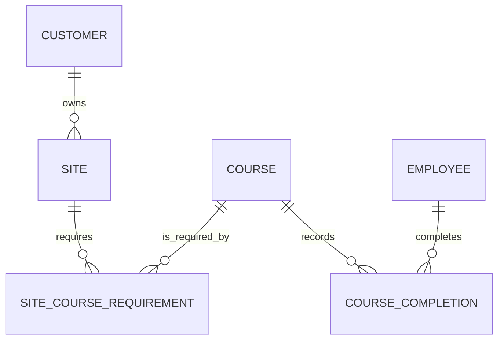

# NME Training Database Design

Status: implemented in Prisma, PostgreSQL migration SQL, Fastify, and the shared seed.

This document defines the recommended PostgreSQL model for the NME training
application. It is based on the current Vue interface, demo data, Fastify API,
Prisma prototype, and the confirmed product rules below.

## Confirmed Product Rules

1. Every active employee appears when any active site is selected.
2. Every active requirement at a site applies equally to every active employee.
   Job title, crew, and role do not change the required courses.
3. A reusable course completion, such as First Aid, can satisfy requirements at
   multiple sites.
4. A site may instead define its own distinct version of a course, such as a
   site-specific Lockout/Tagout course.
5. Company-wide mandatory courses are not part of the product.
6. A course expiry may be entered manually or calculated from a configured
   validity period.
7. An employee is eligible for a site only when every required course is
   current. Missing or expired training makes the employee ineligible.
8. A site with no configured requirements does not grant eligibility.
9. Certificate files, certificate numbers, providers, and approval workflows
   are not required.
10. Waivers, equivalent courses, grace periods, and temporary access are not
    required.
11. There is no external employee number or HR-system identifier.
12. The existing Prisma migration has not been applied to a database that must
    be preserved.

These rules intentionally preserve the current UI behavior: selecting a site
shows every active employee and compares each one with the same list of site
requirements.

## Current Data Inventory

The active frontend demo contains:

- 8 employees;
- 4 customers;
- 4 sites;
- 12 site course definitions; and
- 83 completion records.

As of June 5, 2026, those records intentionally produce a mix of compliant,
expiring, overdue, and incomplete employee-site summaries.

The frontend demo repository and server seed now consume
`src/data/trainingDemoData.json`. The shared dataset preserves the 83 completion
records and their known readiness results at the fixed `as_of` date.

## Why The Prototype Schema Must Change

### Course and site requirement are combined

The current `Course.siteId` design means every course belongs to exactly one
site. A completion for that course therefore cannot satisfy another site's
requirement.

A course and a requirement represent different facts:

- A course defines what an employee completed.
- A site requirement defines which course that site requires.

Separating them allows one First Aid completion to satisfy several sites while
still allowing North Ridge Lockout/Tagout and East Pit Lockout/Tagout to be
different course records.

### Requirement history is missing

The current schema can only say that a course is active or archived. It cannot
say when a site started or stopped requiring it. Effective dates allow
historical readiness reports and prevent course-list edits from changing the
meaning of older reports.

### Integrity rules exist only in API code

PostgreSQL should also enforce:

- expiry on or after completion;
- a positive calculated validity period;
- complete void metadata;
- case-insensitive uniqueness for codes and names; and
- no overlapping requirements for the same site and course.

### Operational timestamps lack time zones

Completion and expiry values are business dates and should remain PostgreSQL
`date` values. Creation, update, audit, archive, and void times should use
`timestamptz`.

## Recommended Domain Model

The production model consists of seven tables:

1. `employee`
2. `customer`
3. `site`
4. `course`
5. `site_course_requirement`
6. `course_completion`
7. `audit_event`

No employee-site assignment table is needed. No employee-requirement join table
is needed because all employees receive the same requirements at a site.

## Table Design

### `employee`

Represents an NME worker, not a Cognito login.

Recommended columns:

- `id uuid primary key`
- `display_name varchar(160) not null`
- `job_title varchar(120) not null`
- `crew varchar(120) null`
- `home_base varchar(120) null`
- `archived_at timestamptz null`
- `created_at timestamptz not null`
- `updated_at timestamptz not null`

The UUID is the employee's application identity. Names should not be unique
because two employees can legitimately have the same name. Without an HR
identifier, administrators must take care not to create duplicate records for
the same person.

Job title, crew, and home base remain plain text because they are descriptive
and do not control requirements.

### `customer`

Recommended columns:

- `id uuid primary key`
- `name varchar(160) not null`
- `contact varchar(160) null`
- `archived_at timestamptz null`
- `created_at timestamptz not null`
- `updated_at timestamptz not null`

Use a case-insensitive unique index for active customer names. A single contact
field is sufficient for the current scope.

### `site`

Recommended columns:

- `id uuid primary key`
- `customer_id uuid not null references customer`
- `name varchar(160) not null`
- `region varchar(160) null`
- `time_zone varchar(80) not null`
- `archived_at timestamptz null`
- `created_at timestamptz not null`
- `updated_at timestamptz not null`

Use a case-insensitive unique index on `(customer_id, name)` for active sites.
The time zone controls what "today" means when readiness is calculated.

### `course`

Represents a reusable training course, certification, or site-specific
orientation. A course does not become required until it is connected to a site
through `site_course_requirement`.

Recommended columns:

- `id uuid primary key`
- `code varchar(50) not null`
- `name varchar(180) not null`
- `category varchar(100) null`
- `default_validity_months smallint null`
- `archived_at timestamptz null`
- `created_at timestamptz not null`
- `updated_at timestamptz not null`

Rules:

- `default_validity_months` is null or greater than zero.
- Course codes are unique case-insensitively for the lifetime of the database.
  Archiving a course never releases its code for reuse.

`default_validity_months` enables calculated expiry but does not prohibit an
administrator from entering the expiry printed on an individual certificate.
This supports both expiry rules without forcing one method for every completion
of the course.

For a reusable credential, create one course and connect it to every site that
requires it. For a site-specific credential, create a separate course with a
site-specific code and connect it only to that site.

For example:

- `SAFE-110 Standard First Aid` can be required by all four sites.
- `AUR-220 North Ridge Lockout/Tagout` can be required only by North Ridge.
- `TUN-220 East Pit Lockout/Tagout` is a different course and completion.

The database does not need a special reusable/site-specific flag. The set of
site requirement rows defines where a course applies.

### `site_course_requirement`

Defines that every active employee must hold a course for a particular site.

Recommended columns:

- `id uuid primary key`
- `site_id uuid not null references site`
- `course_id uuid not null references course`
- `effective_from date not null`
- `effective_to date null`
- `warning_days smallint not null default 45`
- `created_by_subject varchar(255) not null`
- `created_at timestamptz not null`
- `updated_at timestamptz not null`

Constraints:

- `effective_to is null or effective_to >= effective_from`
- `warning_days >= 0`
- prevent overlapping effective periods for the same site and course

Every effective row applies to every active employee. Requirements are always
eligibility-blocking in the current product, so an `is_blocking` column is not
needed.

End a requirement by setting `effective_to`; do not delete it. This preserves
the course list used by historical readiness reports.

A requirement is effective when `effective_from <= as_of` and either
`effective_to is null` or `effective_to >= as_of`; both boundary dates are
inclusive.

### `course_completion`

Represents one occurrence of an employee completing a course. Renewals create
new rows and preserve earlier completions.

Recommended columns:

- `id uuid primary key`
- `employee_id uuid not null references employee`
- `course_id uuid not null references course`
- `completed_on date not null`
- `expires_on date not null`
- `expiry_source completion_expiry_source not null`
- `validity_months_applied smallint null`
- `recorded_by_subject varchar(255) not null`
- `recorded_at timestamptz not null`
- `voided_at timestamptz null`
- `voided_by_subject varchar(255) null`
- `void_reason varchar(500) null`

Recommended `completion_expiry_source` values:

- `MANUAL`
- `CALCULATED`

Rules:

- `expires_on >= completed_on`
- `CALCULATED` requires `validity_months_applied > 0`
- `MANUAL` requires `validity_months_applied is null`
- void time, actor, and reason must either all be null or all be present

The saved `expires_on` is always authoritative:

- For a manual completion, the administrator enters it.
- For a calculated completion, the API adds the course's configured number of
  calendar months to `completed_on`.

Calculated expiry is available only when the course has
`default_validity_months`. Manual expiry remains available for any course.

The calculation uses calendar-month arithmetic, not a fixed number of days. The
API stores both the calculated `expires_on` and the
`validity_months_applied` snapshot. If a course later changes from 12 months to
24 months, existing completions retain their original expiry.

A completion is not tied to a site. This is what allows one reusable course
completion to satisfy several sites. A site-specific course remains isolated
because it has its own course ID.

Void incorrect completion records instead of editing or deleting them.

### `audit_event`

Append-only history for administrative changes.

Recommended columns:

- `id uuid primary key`
- `actor_subject varchar(255) not null`
- `actor_name varchar(255) null`
- `action varchar(100) not null`
- `entity_type varchar(100) not null`
- `entity_id uuid null`
- `request_id varchar(100) null`
- `before_data jsonb null`
- `after_data jsonb null`
- `occurred_at timestamptz not null`

The Cognito subject is the stable administrator identity. `actor_name` is a
readable snapshot. The application database role should not update or delete
audit rows.

## Readiness Rules

Readiness is derived for a selected site and an `as_of` date. Do not store
`compliant`, `expired`, or `eligible` as durable database columns because those
values change as time passes.

The calculation is:

1. Load the selected active site.
2. Load every active employee.
3. Load every site requirement effective on `as_of`.
4. For each employee and required course, find the latest non-voided completion
   where `completed_on <= as_of`.
5. Derive the course status:
   - `incomplete`: no completion exists;
   - `overdue`: `expires_on < as_of`;
   - `expiring`: expiry is between `as_of` and
     `as_of + warning_days`, inclusive;
   - `compliant`: expiry is later than the warning window.
6. Derive employee-site status from the worst required-course status.
7. The employee is eligible only when every requirement is `compliant` or
   `expiring`.

Important empty states:

- If requirements exist but an employee has completed none of them, the
  employee is `incomplete` and ineligible.
- If the site has no effective requirements, every employee is shown with
  `noRequirements` and is ineligible.

`expiring` remains eligible because the course is still current on `as_of`.

The API should accept an optional `asOf=YYYY-MM-DD` query parameter for
historical reports and deterministic tests. When omitted, it should use the
current date in the site's configured time zone.

## PostgreSQL Conventions

Recommended conventions for Prisma and generated migrations:

- native PostgreSQL `uuid`, not text UUIDs;
- database-generated UUID defaults;
- PostgreSQL `date` for completion, expiry, and requirement effective dates;
- `timestamptz(3)` for creation, update, archive, void, and audit times;
- snake_case table and column names through Prisma `@@map` and `@map`;
- `ON DELETE RESTRICT` for all historical business relationships;
- case-insensitive unique indexes using `lower(...)` or `citext`;
- partial indexes for active records and non-voided completions;
- PostgreSQL `CHECK` constraints for date and lifecycle invariants; and
- raw SQL migration additions where Prisma cannot express the constraint or
  partial index.

Useful indexes:

- `employee (lower(display_name)) where archived_at is null`
- unique `customer (lower(name)) where archived_at is null`
- unique `site (customer_id, lower(name)) where archived_at is null`
- unique `course (lower(code))`
- `site_course_requirement (site_id, effective_from, effective_to)`
- a non-overlap constraint for each `(site_id, course_id)` effective date range
- `course_completion (employee_id, course_id, completed_on desc, recorded_at desc)`
  where `voided_at is null`
- `audit_event (entity_type, entity_id, occurred_at desc)`
- `audit_event (actor_subject, occurred_at desc)`

The employee name index is not unique.

In application queries, an employee, customer, site, or course is active when
`archived_at is null`. Requirement activity is determined by its effective date
range rather than an archive flag.

The requirement non-overlap rule can be implemented in raw SQL with a GiST
exclusion constraint over `(site_id, course_id, daterange)`. This requires the
PostgreSQL `btree_gist` extension, which should be enabled in the migration.

## Archive Behavior

- Archiving an employee removes them from current readiness views but preserves
  all completion and audit history.
- A course cannot be archived while it has an open site requirement. End those
  requirements first.
- Archiving a site removes it from current selection while preserving its
  requirements and historical reports.
- A customer can be archived only after all of its sites are archived.
- Archived records are not physically deleted by normal application actions.

## RDS Deployment Decisions

For production:

- keep RDS in private subnets;
- allow PostgreSQL traffic only from the API security group;
- enable encryption at rest with KMS;
- require TLS and validate the RDS certificate chain;
- keep credentials in Secrets Manager and test rotation/reconnection;
- use a non-owner application role with only required DML privileges;
- use a separate migration role for schema changes;
- enable automated backups and point-in-time recovery;
- use Multi-AZ when the required availability justifies its cost;
- test database restoration before launch and periodically afterward; and
- set an explicit Prisma connection limit based on the RDS instance connection
  budget.

The API already reuses one `PrismaClient`, which is appropriate for the current
EC2-style deployment. A bounded Prisma pool is sufficient unless later load
testing demonstrates a need for RDS Proxy.

Official implementation references:

- [Amazon RDS for PostgreSQL](https://docs.aws.amazon.com/AmazonRDS/latest/UserGuide/CHAP_PostgreSQL.html)
- [RDS security best practices](https://docs.aws.amazon.com/AmazonRDS/latest/UserGuide/CHAP_BestPractices.Security.html)
- [RDS PostgreSQL TLS](https://docs.aws.amazon.com/AmazonRDS/latest/UserGuide/PostgreSQL.Concepts.General.SSL.html)
- [RDS automated backups and point-in-time recovery](https://docs.aws.amazon.com/AmazonRDS/latest/UserGuide/USER_WorkingWithAutomatedBackups.html)
- [RDS supported PostgreSQL extensions](https://docs.aws.amazon.com/AmazonRDS/latest/UserGuide/PostgreSQL.Concepts.General.FeatureSupport.Extensions.html)
- [Prisma PostgreSQL native types](https://www.prisma.io/docs/orm/prisma-migrate/workflows/native-database-types)
- [Prisma connection pooling](https://www.prisma.io/docs/orm/prisma-client/setup-and-configuration/databases-connections/connection-pool)

## Implementation

The prototype migration was replaced because it had not been deployed to a
database that needed preservation. The current implementation includes:

1. the seven-table Prisma model and reviewed custom PostgreSQL constraints;
2. shared canonical demo and seed data;
3. effective-dated readiness using reusable course completions;
4. version-based optimistic concurrency;
5. transactional before/after audit events;
6. guarded archive, requirement-ending, renewal, and void workflows; and
7. unit, component, guarded PostgreSQL integration, and Playwright smoke tests.

## Scope Deliberately Excluded

The first production version does not include:

- employee-site assignments;
- role-, crew-, or employee-specific requirements;
- company-wide mandatory requirements;
- certificate evidence or verification;
- waivers or equivalencies;
- grace periods or temporary access;
- external HR synchronization; or
- compatibility with an already-deployed prototype schema.

These features can be added later without changing the central separation
between courses, site requirements, and employee completions.
